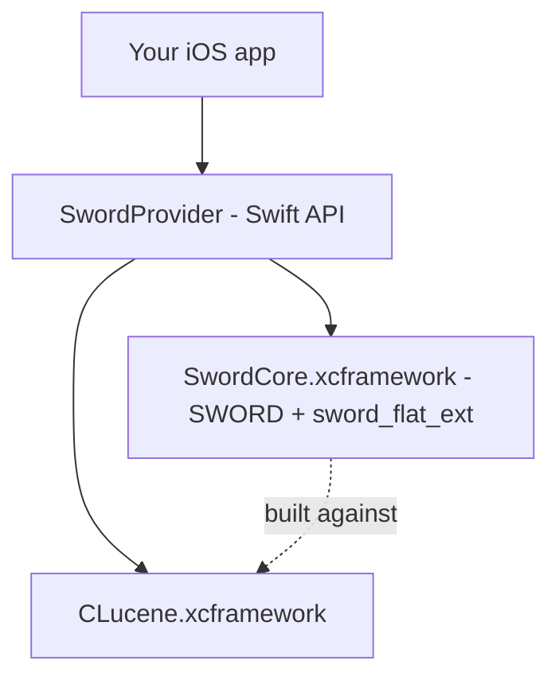

# SwordKit

SwordKit packages the [SWORD](https://crosswire.org/sword/) engine, its search library CLucene, and a Swift wrapper over them, so that any iOS application
(iOS 17 and later) can use SWORD and CLucene by adding one Swift package. It builds SWORD and CLucene from the sources in this repository into
xcframeworks (`SwordCore.xcframework` and `CLucene.xcframework`) and puts the Swift API, `SwordProvider`, on top of them.

The iOS packages are provided as a versioned `SwordCore.xcframework.zip` and `CLucene.xcframework.zip` release, which Swift Package Manager downloads through `Package.swift`.

For Android, SWORD, our C layer and CLucene are linked into one shared library per ABI (arm64-v8a and x86_64), `libsword_android.so`, which the AAR carries. `Android/sword` is the Gradle module (Kotlin classes over a JNI layer, the same shape as `SwordProvider`); `Android/sword-okhttp` is the OkHttp client for the install manager (a module of its own, so the core has no HTTP dependency). What exists and what to ask CrossWire for is in [docs/ANDROID-API.md](docs/ANDROID-API.md). Seventeen instrumented tests pass on an arm64 emulator, including a real download and install over HTTPS. The x86_64 library is built and checked but has not been run (the emulator here is arm64).

**Android limits for now:** bzip2 is not supported. The NDK has no libbz2, so SWORD is built with `EXCLUDEBZIP2` and a module compressed with bzip2 (`CompressType=BZIP2`) will not open there. LZSS (SWORD's own) and zlib work. ICU is not used on either platform.

## Layout

| Path | What it is |
|---|---|
| `Package.swift` | SPM, with two binary targets (`SwordCore.xcframework`, `CLucene.xcframework`) |
| `Sources/SwordProvider/` | Swift over the C layer |
| `Core/` | `CMakeLists.txt`, `sword_flat_ext`, `module.modulemap` |
| `Vendor/sword/` | SWORD engine source, synced by hand |
| `Vendor/clucene/` | CLucene 2.3.3.4 with our patches |
| `Tools/assemble_clucene.sh` | upstream + patches + port into one tree to build |
| `Tools/build_clucene_xcframework.sh` | builds `CLucene.xcframework` |
| `Tools/build_sword_xcframework.sh` | builds `SwordCore.xcframework` and `BUILD-INFO.json` |
| `Tools/update_manifest.py` | writes a release's URLs and checksums into `Package.swift` |
| `.github/workflows/release.yml` | builds and publishes a release |
| `docs/RELEASING.md` | how a release is made |


`sword_flat_ext` extends CrossWire's flat C API `flatapi.h`.
It adds what that API lacks: the install manager and its host-supplied HTTP transport, search and building the index, versification tables, passage parsing, a module's facts as one struct, dictionary keys, and batching (`swx_read_chapter` returns a whole chapter).
It shares the flat API's handles; C functions and types are prefixed `swx_`.
It is plain C, so Swift imports it without C++ interoperability and an Android build can call it through JNI.

## Using it

```swift
.package(url: "https://github.com/logoshub-org/SwordKit.git", from: "1.0.0")
// then: .product(name: "SwordProvider", package: "SwordKit")
```

## Versioning

SwordKit uses [semantic versioning](https://semver.org/): the major version changes when there is a breaking change to the SwordKit API, the minor version when functionality is added, and the patch version for fixes. The version is SwordKit's own and does not follow SWORD's.

The SWORD version a release contains is recorded in `BUILD-INFO.json` (attached to the release) and in the release title, together with the CLucene version, for example: `SwordKit 1.0.0 (SWORD 1.9.0.3981, CLucene 2.3.3.4)`.

## Building

You need a Mac with Xcode (iOS 17 SDK or later) and cmake.

```sh
Tools/build_clucene_xcframework.sh                # once; needs cmake and Xcode
Tools/build_sword_xcframework.sh                  # uses build/CLucene.xcframework; add the path of another, and a version, as arguments
SWORDKIT_LOCAL=1 xcodebuild build -scheme SwordKit -destination 'generic/platform=iOS Simulator'
```

For Android (needs `ANDROID_NDK_HOME`, cmake and make or ninja; the NDK and the SDK's cmake come from Android Studio's SDK Manager):

```sh
Tools/assemble_clucene.sh build/clucene-android && (cd build/clucene-android && bash scripts/build-android.sh all arm64-v8a)
Tools/build_sword_android.sh [abi]                # build/android/<abi>/libsword_android.so and libc++_shared.so (arm64-v8a or x86_64)
Tools/run_android_tests.sh <module folder>        # the instrumented tests on a running emulator (needs JAVA_HOME, ANDROID_HOME)
Tools/package_android_aar.sh <version>            # both ABIs, stripped, then the AARs and a Maven folder in build/android-release/
```

With `SWORDKIT_LOCAL=1`, `Package.swift` uses the two xcframeworks in `build/` instead of the releases. The libraries have iOS slices only, so tests need a simulator (`xcodebuild test`), not `swift test`.

Releases are made manually from the Actions tab (Release, Run workflow), not on push; see [docs/RELEASING.md](docs/RELEASING.md).

## Why two binaries from one repository



SWORD's search code (`swmodule.cpp`) calls CLucene, so SwordCore is built against CLucene's headers and every app must link both. They are in one repository so that the two are built from one commit and cannot drift. They are two binaries because they change at different rates:
SwordCore with every SWORD or C-layer change, CLucene never. CLucene has a release of its own, `clucene-2.3.3.4`, that every SwordKit version names, so SwiftPM downloads it once and keeps it.

## Licence

SWORD's files are GPL-2.0-only; Logos Hub's files are GPL-2.0-or-later; the combined work is GPL-2.0-only. See `LICENSE` and `NOTICE`.

CLucene's terms are in `Vendor/clucene/upstream/` (`COPYING`, `LGPL.license`, `APACHE.license`) and `Vendor/clucene/port/` (`LICENSE`, `NOTICE`, `THIRD_PARTY_LICENSES.md`).
